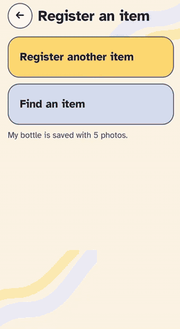
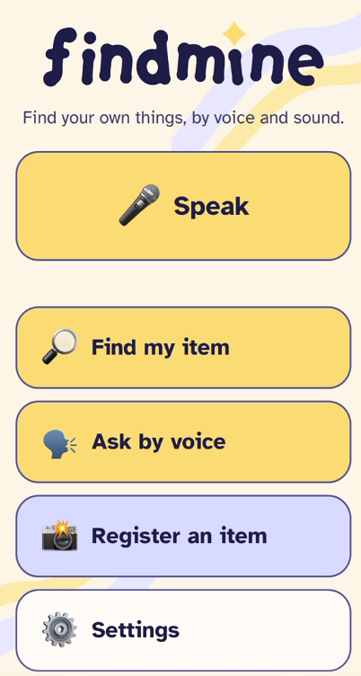
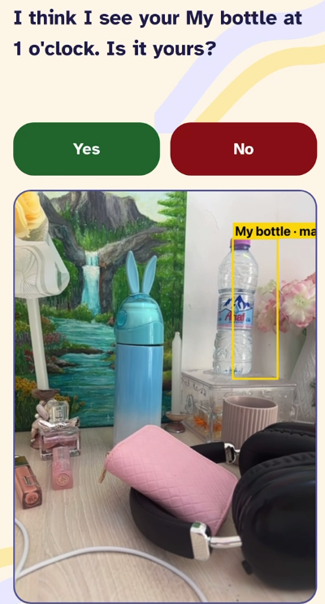
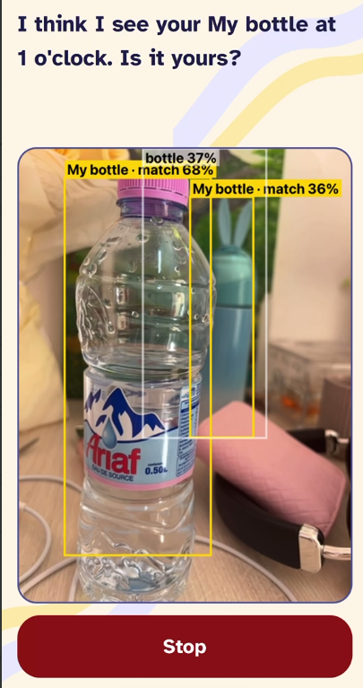
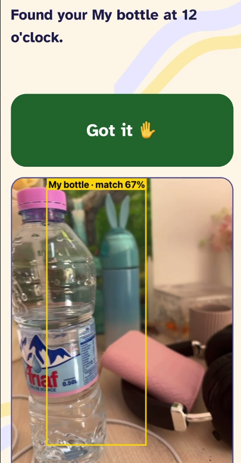
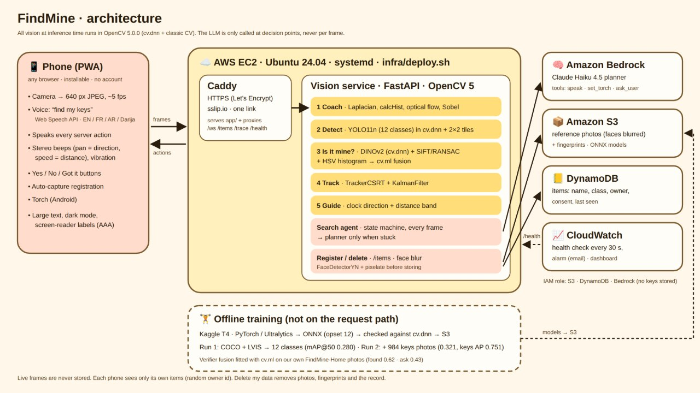
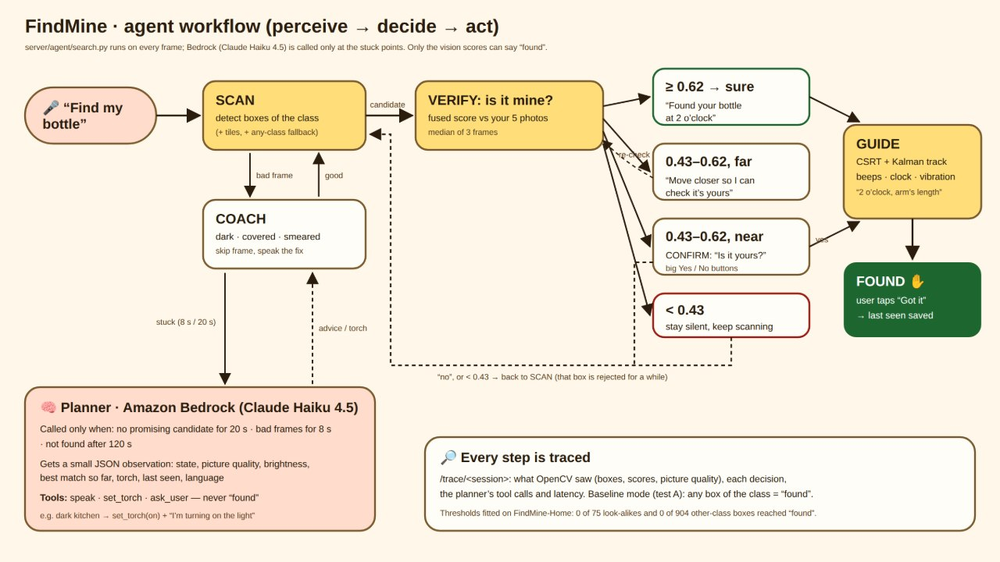

# FindMine

A phone web app that helps blind and low-vision people find their own belongings, by voice and sound.

You register an item once with a few photos. Later you say "find my keys", sweep your phone around the room, and FindMine tells you where it is ("2 o'clock, arm's length") with speech, stereo beeps, and vibration. It checks that it's *your* item, not just any set of keys, and asks you to confirm when it isn't sure.

<p align="center">
  
</p>

<p align="center">
  
  
  
  
</p>

## Features

- Voice commands in English, French, Arabic, and Darija
- Clock-direction and distance guidance, with stereo beeps and vibration
- Tells *your* item apart from look-alikes using your own reference photos
- Coaches you when the picture is too dark, covered, or blurry, and can turn on the torch
- Large text, dark mode, and screen-reader labels (WCAG AAA)
- Installable, no account needed

## Privacy

Live camera frames are never stored. Faces in reference photos are blurred before saving. Each phone only sees its own items, and "delete my data" removes the photos, fingerprints, and record.

## How it works

All vision runs in OpenCV 5 (`cv.dnn` plus classic computer vision) on AWS. A language model (Claude Haiku 4.5 on Amazon Bedrock) is only called when the search gets stuck, and it can never decide that an item was found. Only the vision scores can.





The full plan and requirements are in [planAndSRS.md](planAndSRS.md).

---

## Setup

Commands are for Windows. On Linux or macOS, use `python3` and `.venv/bin/`.

**Vision server** (OpenCV only, no PyTorch):

```
py -3.12 -m venv .venv
.venv/Scripts/python -m pip install -r requirements.txt
```

**Training and export tools** (PyTorch and Ultralytics, never used by the server):

```
py -3.12 -m venv ml/.venv
ml/.venv/Scripts/python -m pip install torch==2.14.1 torchvision==0.29.1 --index-url https://download.pytorch.org/whl/cpu
ml/.venv/Scripts/python -m pip install -r ml/requirements.txt
```

## Data and models

Large files stay out of git (see `.gitignore`).

- `data/coco/`: COCO 2017 annotations from http://images.cocodataset.org/annotations/annotations_trainval2017.zip
- `data/lvis/`: LVIS v1 annotations from https://dl.fbaipublicfiles.com/LVIS/lvis_v1_train.json.zip and `lvis_v1_val.json.zip`
- `models/`: run the export scripts to create the ONNX files:

```
ml/.venv/Scripts/python ml/spike_yolo_dnn.py yolo11n
ml/.venv/Scripts/python ml/spike_embed_dnn.py dinov2
```

The first script also downloads 50 COCO validation images to `data/coco/val50/`, which the server test uses. Results are in [docs/spikes.md](docs/spikes.md).

## Run and test the server

```
.venv/Scripts/python -m uvicorn --app-dir server main:app --host 0.0.0.0 --port 8000
.venv/Scripts/python server/test_server.py
.venv/Scripts/python server/test_search_e2e.py          # full search over /ws, AWS faked in memory
.venv/Scripts/python server/test_planner.py             # add --live on a machine with Bedrock access
.venv/Scripts/python server/test_track.py               # tile search, tracker + Kalman, distance bands
.venv/Scripts/python ml/test_eval_home.py               # evaluation script on a tiny fake home set
.venv/Scripts/python ml/test_summarize_user_tests.py    # user-test summary + Google Form averages
```

## API

**`GET /health`** returns the OpenCV version and the model name.

**`WS /ws`** takes one JPEG per binary message (640 px wide is enough) and replies with one JSON message per frame:

- Usable frame: `{"quality", "w", "h", "detections": [{"label", "conf", "box": [x1, y1, x2, y2]}]}`, with boxes in pixels of the frame you sent.
- Bad frame (camera coach): `{"quality": {"issue": "blur|dark|bright|shake|blocked", ...}, "fix": {"en", "fr", "ar"}}`, with no detections.
- Not a JPEG: `{"error": "..."}`.

**Search** uses text messages on the same `/ws`:

- `{"type": "start", "item_id": "..."}` starts searching for a registered item. Frames then also get a `"match"` score (0 to 1) on boxes of the item's class. While scanning with no box of that class, every third frame is also searched in 2×2 zoomed tiles to catch small objects. `start` may pass `"lang"` (`en`, `fr`, `ar`), and its reply carries `"session"`.
- `"mode": "baseline"` in `start` turns off the "is it mine?" check, so any box of the class counts as found. This is condition A of the user tests.
- `{"type": "answer", "answer": "yes" | "no" | "got_it"}` replies to "is it yours?" or says the item is in hand.
- `{"type": "stop"}` ends the search.

Every reply has a `"state"` (`SCAN`, `COACH`, `CANDIDATE`, `CONFIRM`, `GUIDE`, `FOUND`, `NOT_FOUND`, or `null` with no search) and a list of `"actions"`:

- `{"type": "speak", "key", "text": {"en", "fr", "ar"}}`
- `{"type": "ask_user", "options": ["yes", "no"]}`
- `{"type": "guide", "cx", "cy", "size", "clock", "distance": "near" | "arm" | "far"}`: 0 to 1 coordinates, sent every frame in `GUIDE` and Kalman-smoothed. A CSRT tracker fills in frames the detector misses.
- `{"type": "planner", "event"}`
- `{"type": "save_last_seen"}`

"Found" is only spoken when the match score passes the *found* threshold or after the user says yes (`server/agent/search.py`).

**Planner** (`server/agent/planner.py`): when the search is stuck (no candidate for 20 s, bad frames for 8 s, or not found), the server asks Claude Haiku 4.5 on Bedrock for the next step: `speak`, `set_torch` (phone action `{"type": "torch", "on"}`), or `ask_user`. The model is set by `FINDMINE_PLANNER_MODEL` (default `us.anthropic.claude-haiku-4-5-20251001-v1:0`, us-east-1), and the server needs `bedrock:InvokeModel` through its IAM role on EC2. If Bedrock fails, the user hears the fixed fallback phrase.

**`GET /trace/<session>`** replays a search: what OpenCV saw, each decision, and the planner's tool calls. `/trace` lists the last 50 sessions, and adding `.json` returns the raw records.

**`FINDMINE_MODEL`** sets the ONNX path. The default is `models/findmine12.onnx` (our 12 classes). `models/yolo11n.onnx` is the stock 80-class COCO model. Class names come from the `.json` file next to the model.

## Evaluate on your own items

Put each personal item in `data/home/<class>__<name>/`, where the class is one of the 12 detector classes (for example `keys__house_keys`):

- `ref/` holds the 3 to 5 registration photos.
- `test/` holds room photos or videos where that item is the only one of its class.
- `test/with_other/` holds real search shots with this item and a look-alike of the same class both in view.

Two items of the same class (look-alikes) measure wrong-item errors.

```
.venv/Scripts/python ml/eval_home.py
```

This writes `eval/home_results.csv` (one row per frame and item) and `eval/home_summary.md` (per-item detection and decisions, with precision and recall at the *found* and *ask* thresholds).

`--fit` refits the verifier's fusion weights (a `cv.ml` logistic regression on embedding, geometry, and colour scores) and picks the *found* (precision ≥ 0.95) and *ask* (precision ≥ 0.70) thresholds on these photos, saving them to `models/verifier_fusion.json`. The server reads both at start-up, so commit the file, then `git pull` and re-run `infra/deploy.sh` on the server.

## Deploy on AWS

`infra/deploy.sh` turns a fresh EC2 instance into the running service in one command: system packages, a Python venv with pinned requirements, models from S3, a systemd service (starts on boot, restarts on crash), and Caddy for HTTPS on `<public-ip-with-dashes>.sslip.io`. Re-run it after every `git pull`.

Once per account (AWS console, us-east-1):

1. **Models to S3:** upload `models/findmine12.onnx` and `models/dinov2_vits14.onnx` to `s3://findmine-items-bucket/models/`. The face-blur model (`face_detection_yunet_2023mar.onnx`) is downloaded by `deploy.sh` itself. To run locally, download it from [opencv_zoo](https://github.com/opencv/opencv_zoo/tree/main/models/face_detection_yunet).
2. **IAM role** for the instance with `s3:GetObject` and `s3:PutObject` on the bucket, `dynamodb:GetItem`, `PutItem`, `UpdateItem`, and `Scan` on `findmine-items`, and `bedrock:InvokeModel`.
3. **Instance:** Ubuntu 24.04 (arm64 for Graviton, such as `t4g.medium` or `c7g.large`, or x86 `c7i-flex.large` for the baseline), with the IAM role above and a security group open on 22 (your IP), 80, and 443.

Then on the instance:

```
git clone https://github.com/minna-chouit/FindMine.git && cd FindMine && bash infra/deploy.sh
```

It ends with `DEPLOYED: https://<ip>.sslip.io`. The phone app connects to `wss://<ip>.sslip.io/ws`, and the PWA pages are served from `app/`.

- Logs: `sudo journalctl -u findmine -f`
- Stop the instance when nobody is testing to keep costs at zero.
- If an older copy of the server was started by hand on port 8000, stop it first.

## User tests

The protocol (setup, 4 rounds per volunteer, A baseline vs B FindMine, normal vs low light) is in [eval/test_protocol.md](eval/test_protocol.md), and the Google Form content is in [eval/consent_form.md](eval/consent_form.md).

Fill in `eval/user_trials.csv` during the tests, save the form export as `eval/form_responses.csv`, then run:

```
.venv/Scripts/python ml/summarize_user_tests.py
```

## Licences

Ultralytics YOLO is AGPL-3.0. DINOv2 is Apache-2.0.
