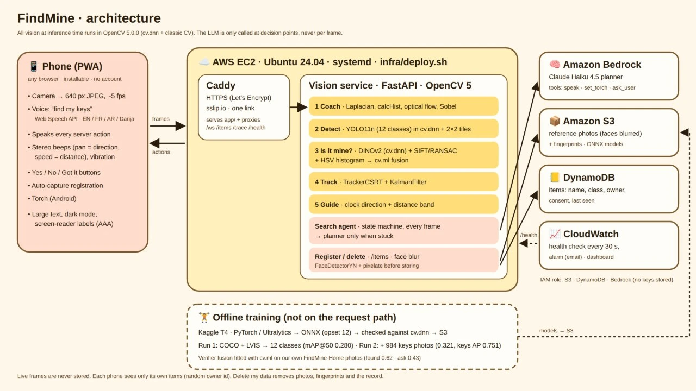
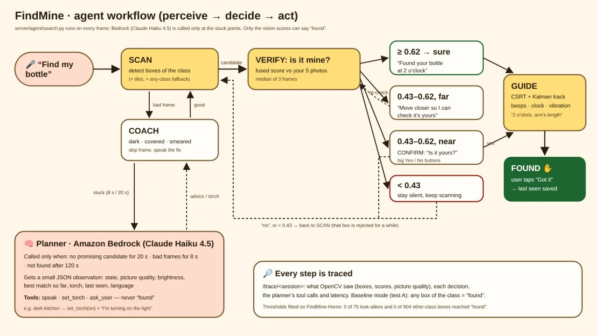

# FindMine: helping blind and low-vision people find *their own* things

**OpenCV AI Competition 2026 · technical report** · Team: Minet Ellah Chouit, Takoua Hidoussi · Live app: https://54-90-98-230.sslip.io/ ·
Code: https://github.com/minna-chouit/FindMine · Video: https://youtu.be/ghpWFQpnacw

> Every number below comes from a script in this repo; the script is named next to it.

## 1. Problem and users

Losing keys, a phone or a cup costs a sighted person a glance. For a blind person it means sweeping hands
over every surface, often asking someone else. Apps such as Seeing AI, Lookout or Be My AI can say *"a cup"*,
but people own several cups: the useful question is *"where is **my** cup?"*.

FindMine is a phone web app for blind and low-vision users (and the sighted helpers who sometimes set it up):

1. **Register** an item once: the phone takes 5 photos, guided by voice and beeps.
2. **Search**: say *"find my keys"* (English, French, Arabic, some Darija). The phone streams the camera to the
   server; FindMine coaches the camera, spots objects of the right kind, checks whether one is *yours*, and
   guides the hand to it with clock directions ("at 2 o'clock"), stereo beeps and vibration.
3. **Safety first**: FindMine never says "found" unless it is sure; otherwise it asks *"is it yours?"*, and
   when the candidate is far away it first says *"move closer so I can check it's yours."*

## 2. Architecture

| Part | Runs on | What it does |
|---|---|---|
| Phone app (PWA) | the phone's browser | camera → 640 px JPEG frames over a WebSocket; speaks, beeps (stereo pan = direction), vibrates, torch; voice commands (Web Speech API) |
| Vision service | **AWS EC2** `c7i-flex.large` (x86), Python 3.12, FastAPI, **OpenCV 5.0.0** | coach → detect → verify → track → guide, per frame |
| Search agent | same service + **Amazon Bedrock** (Claude Haiku 4.5) | state machine every frame; LLM planner only at decision points |
| Storage | **S3** (registration photos, face-blurred, + their features) · **DynamoDB** (items, last seen) | no live frame is ever stored |
| Delivery | Caddy (HTTPS on sslip.io), systemd (restart on crash), `infra/deploy.sh` (one command) | |

## 3. OpenCV 5 implementation

All vision at inference time is OpenCV 5 (`opencv-contrib-python==5.0.0.93`); PyTorch is only used to train and
export. Pipeline per frame (`server/main.py`):

| Step | OpenCV 5 APIs | Notes |
|---|---|---|
| **Camera coach** (`pipeline/coach.py`) | `Laplacian` variance (blur), `calcHist` (dark/bright clipping), `goodFeaturesToTrack` + `calcOpticalFlowPyrLK` (shake), `Sobel` + `connectedComponentsWithStats` (finger on the lens) | *issue* = frame skipped (dark, bright, blocked, moving-and-smeared); *hint* = frame still searched, tip spoken at most every 10 s (blurry, fast-but-sharp sweep) |
| **Detector** (`pipeline/detect.py`) | `dnn.readNetFromONNX`, `dnn.blobFromImage`, `dnn.NMSBoxes` | YOLO11n fine-tuned on 12 everyday classes; 2×2 tile search for small objects when nothing is found |
| **Is it mine?** (`pipeline/verify.py`) | `dnn` (DINOv2-small embeddings), `SIFT_create` + `BFMatcher` ratio test + `findHomography(RANSAC)`, HSV `calcHist` + `compareHist`, `ml.LogisticRegression` fusion | crop compared with the item's 5 reference photos; fused into one score with two thresholds: *found* 0.62, *ask* 0.43 |
| **Tracking** (`pipeline/track.py`) | `TrackerCSRT`, `KalmanFilter` (constant velocity on centre and size) | keeps the beeps steady between detections once the item is confirmed |
| **Guidance** (`pipeline/guide.py`) | pinhole distance from box size × typical object size | clock hour from the box centre (65° HFOV), near / arm's length / far |
| **Privacy** (`pipeline/privacy.py`) | `FaceDetectorYN` (YuNet) + pixelation + `GaussianBlur` | every stored registration photo; up to 3 passes |

**Model notes** (`docs/spikes.md`, `eval/detector_run1.md`)

- Detector run 1: YOLO11n from COCO weights, COCO 2017 + LVIS v1 merged into 12 classes (31,786 train / 1,341
  val images, `docs/class_counts.md`), 70 epochs on a Kaggle T4. val mAP@50 **0.280**. Exported to ONNX
  (opset 12); cv.dnn matches onnxruntime within 7e-3; 64 ms/frame on a laptop CPU.
- Detector run 2, **deployed** on Oct 25 (`eval/run2_report.md`): fine-tuned from run 1 on a Kaggle T4 for
  30 epochs (learning rate 0.002, no warm-up) with 984 public keys photos (Roboflow Universe, CC BY 4.0), every
  run-1 image of a weak class, and 6,000 run-1 images replayed so it doesn't forget. val mAP@50 0.268 → **0.321**;
  keys AP@50 0.004 → 0.751 (optimistic: those val images come from the same keys dataset).
  `ml/kaggle_finetune_run2.ipynb`, `docs/finetune_keys.md`.
- Detector run 3, trained Oct 25–26, **not deployed** (`eval/run3_report.md`): fine-tuned from run 2 with
  public wallet, earbuds and medicine-box sets (Roboflow Universe) plus the keys set, same recipe. val mAP@50
  0.317 → **0.413**; wallet AP@50 0.168 → 0.869, earbuds 0.051 → 0.406, medicine 0.058 → 0.135, keys 0.677 → 0.778
  (optimistic again: val images come from the training sources). `ml/kaggle_finetune_run3.ipynb`, `docs/finetune_run3.md`.
- Verifier: DINOv2-small in cv.dnn (cosine to PyTorch ≥ 0.9993, 110 ms/crop on a laptop; needs an export
  wrapper, see `docs/spikes.md`). Fusion weights fitted with `cv.ml` on our own photos: bias −1.81,
  embedding 1.73, geometry 0.57, colour 1.02.

## 4. The agent: perceive → decide → act

The search is a state machine (`server/agent/search.py`) that runs on every frame:
`SCAN → CANDIDATE → VERIFY → (FOUND | CONFIRM | "move closer") → GUIDE → FOUND`, plus `COACH` for bad frames.
What OpenCV sees decides the next action:

| OpenCV output | Next action |
|---|---|
| frame dark / blocked / smeared | skip detection, speak the fix; after 8 s → **planner** |
| fused score ≥ *found* (median of 3 frames) | "Found your cup at 2 o'clock" → guide with beeps |
| *ask* ≤ score < *found*, item **far** | "Something like your cup at 2 o'clock. **Move closer** so I can check it's yours" |
| *ask* ≤ score < *found*, item near | "Is it yours?" → user answers yes / no |
| no promising candidate for 20 s | "Turn slowly…" → **planner** |

The **LLM planner** (`server/agent/planner.py`, Bedrock, Claude Haiku 4.5) is called only at those decision
points, never per frame. It receives a compact JSON observation (state, picture quality, brightness, best match
so far, torch, last seen) and must answer with tool calls: `speak`, `set_torch`, `ask_user`. It is told never to
claim the item is found; only the vision system decides that. Every step (OpenCV observation, decision,
actions, planner tools and latency) is logged and replayed at `/trace/<session>`.

A real trace from a tester (session `858cd0c0`, Oct 26): 2.4 s candidate, median score 0.45 → "is it yours?" (no answer, back to scan) → 16.3 s second candidate, 0.43 → "is it yours?" → **yes** → guided by beeps and clock direction → **"Got it" at 20.2 s**.

## 5. AWS deployment

- **Compute:** one EC2 instance `c7i-flex.large` running the vision service under systemd (restarts on crash),
  Caddy for HTTPS. `infra/deploy.sh` turns a fresh instance into the running service in one command
  (packages, pinned Python requirements, models from S3, face model from OpenCV's model zoo, service, HTTPS,
  health check).
- **S3:** registration photos (faces pixelated) and their features; detector and verifier models.
- **DynamoDB:** one row per item (name, class, owner id, consent, last seen).
- **Bedrock:** the planner; ~1.5 s per call in our traces, a few calls per search at most.
- **Budget:** Free-plan credits only; training ran on Kaggle, not AWS.
- We did not run the COOL / Graviton benchmark: the service runs on an x86 `c7i-flex.large` instance.

## 6. Evaluation

### 6.1 Data

**FindMine-Home** (`data/home`): our own photos and videos of 10 personal items in 6 classes (3 bags,
2 bottles, 2 sets of keys, cup, phone, headphones): 5 reference photos per item, test photos and videos in rooms,
with look-alikes. Public data: COCO 2017, LVIS v1 (detector), Roboflow Universe keys (run 2), wallet, earbuds and medicine
boxes (run 3).

### 6.2 Detection on our own videos (`ml/compare_detectors.py`, conf 0.25, 2 fps; never used for training)

| Item | Run 1 | Run 2 (deployed) |
|---|---|---|
| juice bottle / water bottle | 7/7 · 7/7 (100%) | 7/7 · 7/7 (100%) |
| cup | 14/17 (82%) | 13/17 (76%) |
| phone | 17/21 (81%) | 15/21 (71%) |
| 3 bags | 42–52% | 38–52% |
| headphones (detected as earbuds) | 0/29 | 5/29 (17%) |
| **keys**, close-up photos | 0/11 | **9/11** (10/11 at conf 0.15) |
| **keys**, search frames | 0/40 | 2/40; **8/40 with 2×2 zoomed tiles** (23/40 at conf 0.05) |

Run 2 learned keys: it recognises our own keys up close, which run 1 never did. In search shots the keys are
only a few dozen pixels wide, so they are found mainly by the tile search (the server runs it every 3rd frame
while nothing of the item's class is in view), mostly below the 0.25 threshold. The small drops on cup and phone
are 1–2 frames each. With run 2 the look-alike checks are unchanged: 0 of 75 same-class look-alikes and 0 of 939
other-class boxes at or above *found*.

**Run 3** (`eval/run3_report.md`, `eval/detector_compare_run3.md`, `ml/eval_tiles.py`), tested on our own wallets
and medicine (box, bottle, blister pack) added for it: no item drops more than 10 points; headphones (as earbuds)
17% → **45%**; keys with tiles 8/40 → **21/40** with fewer false keys boxes (21 → 6 of 292 frames). But wallets
are only learned up close (0/13 → 5/13 close-ups, room shots with tiles 3/10 → 1/10) and false wallet boxes rise
from 2 to 45 of 322 frames; the public medicine-box set did not transfer to our medicine (0/14 close-ups for
both). So **run 2 stays deployed**: public product photos taught the close-up look, not the small object in a
room that a search sees. Raising the wallet threshold alone doesn't rescue it: false wallets only fall back to run 2's
level at 0.75, where our wallets are no longer found in room shots (`ml/eval_class_threshold.py`).

### 6.3 Camera coach: blur is a hint, not a reason to skip (bottle/cup/bag/phone videos, 367 frames at 5 fps)

The detector still found the item in 47% of frames the coach called "blurry", but only in 20% of frames that
were moving *and* smeared. Making blur a spoken hint instead of a skip:

| | Frames that reach the detector | Frames where the item is found |
|---|---|---|
| before | 31% | 24% |
| after | **72%** | **45%** |

### 6.4 Is it *mine*? (`ml/eval_home.py`, `ml/eval_cross_class.py`)

| Check | Result |
|---|---|
| Same-class look-alikes at or above *found* (0.62) | **0 of 75** (precision 1.00; recall 0.08) |
| Other-class boxes (any-class fallback) at or above *found* / *ask* | **0 / 0 of 904** (highest 0.429) |
| *ask* 0.43 on search frames | precision ≈ 0.80 (target ≥ 0.70) |

**Main finding: telling *yours* from a look-alike works up close, not from afar.** AUC (0.5 = coin flip):

| Signal | Close-up reference photos | Search-distance frames |
|---|---|---|
| embedding | 0.87 | 0.45 |
| colour | 0.81 | 0.36 |
| geometry | 0.57 | 0.41 |
| **fused** | **0.91** | **0.37** |

So FindMine finds the right *kind* of object from across the room, and checks that it is *yours* once the user
is close. The agent's "move closer" step comes straight from this result. (Search-frame look-alike sample:
18 frames; small.)

### 6.5 User test (blindfolded volunteers) · `eval/test_protocol.md`, `ml/summarize_user_tests.py`

We could not run the planned blindfolded A/B study (`eval/test_protocol.md`) in time. Instead, testers used the
live app on their own phones with eyes closed and filled in a short form after each search: **4 searches by
3 people** on Oct 26 (1 full app, 3 baseline), all reported "found my item". That is a pilot, too small to compare
A and B. The 2 people who answered the end questions rated (1–5): guidance 4 and 5, trust in "found" / "is it
yours?" 5 and 4, easy with eyes closed 3 and 4.

"Is it yours?" answers during all searches on Oct 26, including ours (`ml/answers_from_traces.py`,
`eval/answers_summary.md`): asked 15 times in 11 searches; 6 yes, 1 no, **8 no answer** (the question times out
after 10 s). Of the answered asks, 6 of 7 (0.86) were the user's item.

### 6.6 Privacy check (`server/test_privacy.py`)

3 COCO crowd photos (17, 12 and 4 faces) → **0** faces detectable after blurring; a photo without faces is
stored unchanged (27 ms). A plain blur left 9 of 17 small faces detectable, so we pixelate, in up to 3 passes.
Example: `eval/face_blur_example.jpg`.

### 6.7 Latency

Laptop CPU: detector 64 ms/frame (run 2 is the same YOLO11n size), DINOv2 110 ms per verified crop (at most 2 per frame).
Frame round trip on the EC2 instance was not measured; the live traces show one decision every 0.4–1.3 s.

## 7. Limitations and failure cases

- **Keys:** run 1 never boxed keys. Run 2 recognises them up close (9/11 at conf 0.25) but finds them in only 8 of 40 search
  frames at the normal threshold: they are tiny at search distance. Next steps: train with our own keys frames
  from a distance (`ml/extract_frames.py`), a larger input size for small objects, or a lower threshold for keys
  inside tiles (17/40 at 0.15, with more false keys boxes for the item check to reject).
- **Plain objects** (a white cup) lose two of three signals (no texture for geometry, colour shifts with light),
  so they sit around the *ask* threshold and are rarely "found" outright.
- **At search distance** "mine vs look-alike" is close to chance; FindMine asks the user to move closer.
- **Headphones, cables** are not among the 12 classes.
- **Data is small:** 10 items, mostly two homes/one school; 75 same-class look-alike rows (18 on search frames).
- The phone needs a connection; the server is a single instance.
- `/trace` and `/items` have no login (fine for the demo and judges, not for real users).
- **Live use:** testers left "is it yours?" unanswered 8 of 15 times (it times out after 10 s), and one full-app search ended in repeated "lens blocked / too dark" coaching although the tester found the item by hand.

## 8. Responsible use

- **Never claims what it isn't sure of:** "found" needs a fused score ≥ 0.62 (0 look-alikes above it in our
  tests); below that it asks, and the planner is instructed never to say an item was found.
- **Privacy:** live camera frames are never stored; registration photos have faces pixelated before storage;
  each phone only sees its own items (random per-phone id, no account); consent checkbox before any photo can be
  used to improve the app.
- **Accessibility:** WCAG 2.2 AA (AAA contrast), screen-reader labels, speech + beeps + vibration, large text
  options (`docs/accessibility.md`).
- **Not a mobility aid:** FindMine finds belongings; it does not detect obstacles or stairs (spoken on first use).
- **User tests:** volunteers gave consent, could stop at any time, a spotter stayed next to them.

## 9. Reproduce

See `README.md`: `pip install -r requirements.txt` · `infra/deploy.sh` on EC2 · tests: `server/test_*.py` ·
evaluation: `ml/eval_home.py`, `ml/eval_cross_class.py`, `ml/compare_detectors.py` · training:
`ml/kaggle_train_run1.ipynb`, `ml/kaggle_finetune_run2.ipynb` (`docs/finetune_keys.md`),
`ml/kaggle_finetune_run3.ipynb` (`docs/finetune_run3.md`).

## Credits

COCO 2017 (annotations CC BY 4.0), LVIS v1 (CC BY 4.0), Roboflow Universe keys dataset by main-m4puh
(keys-wd8b7, CC BY 4.0), wallet by senior-project-final-datasets (wallet-nfk4a, Public Domain), earbuds by
aquamanj (pen-calculator-earbuds-ecdso, CC BY 4.0), medicine boxes by teknofest-r4zmp (medicine-d7ttn, CC BY 4.0),
YOLO11 (Ultralytics, AGPL-3.0), DINOv2 (Meta, Apache-2.0), YuNet face detector
(OpenCV model zoo, MIT), OpenCV 5 (Apache-2.0).
